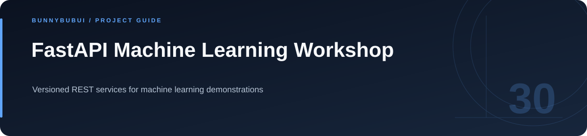

<p align="center">
  
</p>

<h1 align="center">FastAPI Machine Learning Workshop</h1>

<p align="center">Versioned REST services for machine learning demonstrations</p>

<p align="center">
     
</p>

<p align="center"><a href="#overview">ภาพรวม</a> · <a href="#start">เริ่มใช้งาน</a> · <a href="#structure">ไฟล์สำคัญ</a></p>

<a id="overview"></a>

## ภาพรวม

ชุด API workshop แบ่ง route, schema และ service ตามหมวดงานและรุ่น API โปรดเตรียม dependencies และ model artifacts ก่อนเริ่ม server

<a id="start"></a>

## เริ่มต้นใช้งาน

```sh
python -m venv .venv
# Activate .venv for your operating system.
python -m pip install -r requirements.txt
cd app
python -m uvicorn main:app --reload --port 8001
```

กำหนด `ML_MODEL_DIR` เมื่อต้องการ override ตำแหน่งโมเดล และเริ่ม companion frontend ด้วย API base ที่ตรงกัน

<a id="structure"></a>

## ไฟล์สำคัญ

| ตำแหน่ง | หน้าที่ |
|---|---|
| [app/](app) | พื้นที่งาน / ไฟล์ประกอบ |

<a id="configuration"></a>

## ตัวอย่างการตั้งค่า

ตัวอย่างค่าตั้งค่าอยู่ในไฟล์ต่อไปนี้ คัดลอกไปยังชื่อไฟล์ local ที่โปรเจกต์อ่านและกำหนดค่าของเครื่องที่ใช้

| ไฟล์ตัวอย่าง | ตัวแปรสำคัญ |
|---|---|
| [.env.example](.env.example) | `ML_MODEL_DIR` |

<a id="reading"></a>

## อ่านต่อ

- [รายละเอียด implementation](docs/IMPLEMENTATION_GUIDE.md)
- [กลับ README หลัก](../README.md)


---

<p align="center"><a href="https://github.com/BunnyBubui">BunnyBubui</a> · <a href="https://github.com/BunnyBubui/test">Software Portfolio</a></p>
