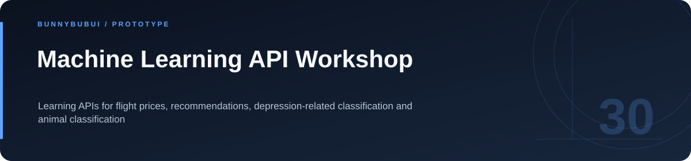

<p align="center">
  
</p>

<h1 align="center">Machine Learning API Workshop</h1>

<p align="center">Learning APIs for flight prices, recommendations, depression-related classification and animal classification</p>

<p align="center">
       
</p>

<p align="center"><a href="#overview">ภาพรวม</a> · <a href="#features">ความสามารถ</a> · <a href="#start">เริ่มใช้งาน</a> · <a href="#structure">โครงสร้าง</a> · <a href="#validation">ตรวจสอบงาน</a></p>

<a id="overview"></a>

## ภาพรวม

ชุด workshop สำหรับให้บริการโมเดลผ่าน FastAPI แยก API เป็นรุ่นและหมวดงาน เช่นราคาตั๋วเครื่องบิน การแนะนำ และการจำแนกข้อมูล

<a id="features"></a>

## ความสามารถที่มีใน source

| ส่วนงาน | รายละเอียด | อ้างอิง |
|---|---|---|
| **Versioned APIs** | แบ่ง route ตาม v1 และ v2 | [ดู source](FASTAPI-LM-main/app/api/) |
| **Model services** | แยก schema, route และ service | [ดู source](FASTAPI-LM-main/app/api/v2/) |
| **Training example** | ตัวอย่างฝึกโมเดลราคาตั๋ว | [ดู source](FASTAPI-LM-main/app/api/v2/flight/train_flight_price.py) |

<a id="start"></a>

## เริ่มต้นใช้งาน

**สิ่งที่ต้องมี:** Python และ dependencies ตาม requirements ของ workshop รวมโมเดลที่ route ใช้งาน

```sh
cd FASTAPI-LM-main
python -m venv .venv
# Activate .venv for your operating system.
python -m pip install -r requirements.txt
cd app
python -m uvicorn main:app --reload --port 8001
```

ตั้ง `ML_MODEL_DIR` เป็น absolute path เมื่อต้องการเก็บโมเดลนอก `app/models/`; บาง service โหลดโมเดลทันทีเมื่อ import

<a id="configuration"></a>

## การตั้งค่า

ตัวอย่างค่าตั้งค่าอยู่ในไฟล์ต่อไปนี้ คัดลอกไปยังชื่อไฟล์ local ที่โปรเจกต์อ่านและกำหนดค่าของเครื่องที่ใช้

| ไฟล์ตัวอย่าง | ตัวแปรสำคัญ |
|---|---|
| [FASTAPI-LM-main/.env.example](FASTAPI-LM-main/.env.example) | `ML_MODEL_DIR` |

<a id="structure"></a>

## โครงสร้างที่ควรเริ่มอ่าน

| ตำแหน่ง | หน้าที่ |
|---|---|
| [FASTAPI-LM-main/](FASTAPI-LM-main) | FastAPI และบริการโมเดล |

<a id="validation"></a>

## คำสั่งและผลตรวจ

repository นี้ไม่ได้กำหนดชุด automated tests สำหรับทุก flow; ตรวจผลจาก entry point และข้อมูลสาธิตที่เกี่ยวข้อง

<a id="scope"></a>

## ขอบเขตของงาน

โมเดลด้านสุขภาพเป็นงานเรียนรู้ ไม่ใช่เครื่องมือที่ผ่านการประเมินทางคลินิก

<a id="reading"></a>

## อ่านต่อ

- [บันทึกการเตรียม source](docs/CLEANUP.md)


---

<p align="center"><a href="https://github.com/BunnyBubui">BunnyBubui</a> · <a href="https://github.com/BunnyBubui/test">Software Portfolio</a></p>
